# Fixion / DRDR: the mobile UX proposal (speech, the action menu, the mic in the menu)

Written 2026-10-27 (18:30 JST). Built on `docs/philosophy/PHILOSOPHY.md`, `ONTOLOGY.md` and `UX_IMPLICATIONS.md`
in the drdr-dr tree, on the audit in `current_state.md` (failure points F1 to F8) and on `research.md`. Phone
portrait first, iPhone Safari, the HTML5 build of the DragonRuby game. Everything here is implementable with what
DragonRuby 7.18 already does in HTML5: additive sprites, render targets, labels. No shaders.

Interactive mockups (touch and mouse, both skins, each state replayable): [talk](mock/talk.html) ·
[menu](mock/menu.html) · [mic to action](mock/slot.html). Clips: `../media/`. The implementation brief for the next
round is `fix_brief.md`.

Josh's answers that shaped this (18:09 JST): show the player's own words in the feed by default (yes); the
green indicator above the player while speaking comes back, in both skins; rewrites should be smooth; whether every
spoken action waits for a confirm and whether a red reason is final are left to this proposal; a session is "for now
just being in the scene".

> **Relation to the fix10 round (in progress at 18:25 JST).** fix10.md (18:05 JST) was written from the same audit and
> is already building most of this: live partials, a *connecting* state, a speech pill over the mic, the slot with its
> phases, up/down-only selection with ✓/✕, a raised ACT, standing beams in the slot, a confirm policy, haptics.
> Where this proposal differs it says so; `fix_brief.md` lists the deltas for the round after fix10. The two
> disagreements that need Josh: the menu card's place (fix10 docks it low near the thumbs; this proposal keeps it
> beside the target) and whether a rewrite may auto-confirm (fix10: after a delay; this proposal: never).

### Changelog

- **21:52 JST, Josh after fix10 (relayed by Base Models, approved "yeah"), and his follow-up "what i say shouldn't be
  on screen, it should only go in feed":** plain talking is **invisible** again. When the player talks (not an
  action), the line just goes into the feed. There is no live transcript, no take card or pill, no speech bubble or
  caption over the player, no floating text and no stage labels (listening / heard / sent, "MIC WARMING",
  "didn't catch that", "let go · hold again"). The ✓ badge and the finalizing dots on the mic are gone too. ACT is
  **not lifted**: the 72 px raise is undone in the talk, menu and slot mockups and here. Josh's earlier wish for
  confirmation was about **lost speech**, not visible feedback; it is now an engineering guarantee in the bridge
  (§1c), not a screen element. Kept: the green speaking indicator over the `@` (Josh asked for it), the mic button's
  own press state, a dashed arming ring on the button, a tiny button shake when nothing was sent, and "MIC BLOCKED"
  on the button for a denied permission (the one state the player must fix). The action-menu flow is unchanged:
  the slot opens at the bottom, words type into the slot, no beam, the slot flashes, the words morph into the label,
  and it presses or waits for ✓. Changed: §0 rows 1–4 and 7, §1 (all), §2a, §4, §5, §6, §7, §8, §9 Q3, the talk
  and menu mockups, and every clip (the A clips for talk; B and C for ACT's position).
- **21:38 JST, Josh:** "i also don't want the 'line' or 'beam' from action mic to slot." The mic-to-slot ray is
  **removed** everywhere: no beam, no thread, no glyph motes between the mic and the slot. Everything else in the slot
  flow stays: it opens at the very bottom, the words type in, morph into the label, and press (or wait for ✓). So the
  "speech went through" signal is not lost, the slot itself flashes once, softly (a 380 ms violet brightening of its
  own border and fill), as the heard words arrive. Changed: §0 row 9, §2c, §3a, §3b steps 1–5, §4, §5, §6, the slot
  mockup and the C clips.
- **18:45 JST, Josh on the published proposal:** "make the inspire action at the very bottom. also no need to maintain
  the line". Read as:
  1. The spoken (inspire) action's slot always opens at the **very bottom of the action menu**, below every row, not
     under the selected row. The selection jumps to the slot while speaking. After it is performed, the new row stays
     at the bottom. ✕ while the slot is open puts the selection back on the row it was on.
  2. **No struck-through original.** The heard words morph straight into the judged label, rewrite or not, and no
     strikethrough line is kept in the slot. A gated rewrite still asks "do this instead?" on the strip, without the
     original line. (The light ray from the mic to the slot was kept at 18:45 as a VFX; removed at 21:38, above.)

  Changed: §0 rows 9–10, §3a, §3b steps 1, 5 and 7, §4 (slot open, morph; the struck-subline row is removed), §5,
  §8 (P5), the slot mockup and the C clips. Unchanged and open for Josh: the feed's existing struck-through rewrite
  line at the perform step (fix3 behaviour, part of the transcript, not the slot).

---

## 0. The decisions in one screen

| # | Decision | From which principle |
|---|---|---|
| 1 | While talking: no words on screen, a green mic, and five green level bars over the `@` in both skins. What the player says is **never on screen**; it only goes into the feed. | P4 speech is the main verb; Josh's capture rule |
| 2 | On release: **nothing on screen**. No take card, pill, transcript or stage label; the line just appears in the feed as `ADVENTURER: …`. | Josh after fix10 (talking is invisible) |
| 3 | A press never lights green until audio is flowing. Before that the mic is **arming** (grey dashed ring). Releasing while arming never finalizes; the mic button gives a tiny shake, no text. | F3 (the iOS first-press race); orb-ui's "connecting" rule |
| 4 | Failures stay on the mic button: *arming* (grey dashed ring), *nothing sent* (a tiny shake), *blocked* (greyed with "MIC BLOCKED", the one persistent state). Socket errors are retried, not shown. Lost speech is prevented in the bridge, not signalled on screen. | Josh after fix10; research §1 |
| 5 | In Act mode the left stick moves the selection **up and down only**. Left and right do nothing. | F6 mixed semantics |
| 6 | The ✕ (red) ✓ (green) pair appears in its own strip **under the selected row**, rows below move down with it (160 ms). ✓ commits; tapping the selected row again also commits; ACT leaves. | Josh's ask; HIG symbols; Xbox A/B colours |
| 7 | ACT stays where it is, level with the mic (**not lifted**; the 72 px raise is undone). | Josh after fix10 |
| 8 | The commit is a moment: press state (white wash 80 ms), hitstop 90 ms, a glyph ring, sparks, a 1800→600 Hz tick; the menu stays 400 ms, then leaves in 200 ms. | P9 timing; 글자들 `contact()` |
| 9 | Pressing the mic in the menu slides a **slot** open at the **very bottom of the menu**, below every row, and the selection jumps to it (220 ms); while speaking the slot's dashed border marches (no beam from the mic); on release the slot flashes once and the heard words type in (≤400 ms); the judge runs under a sweeping underline. | Josh's ask; P1 the screenplay is the world |
| 10 | The judged label **lands in the slot**: the heard words **morph straight into the label** (320 ms glyph churn, rewrite or not); nothing of the original is kept. The slot is pressed (same moment as 8), performed, and becomes an ordinary row with a violet dot, staying at the bottom of the menu; the menu stays 1.1 s. | F4; P5 intent in, outcome out |
| 11 | **Gate rule (Q2):** a spoken action performs at once when the judge said `ok` or `duplicate` with P ≥ 0.75 **and** the preset is not hostile. Any rewrite, any doubt, any hostile act (hit/shoot/shove/grab) waits in the slot for ✓/✕. | P5, P10; F1 (the 양 hit) |
| 12 | A red **reason** lands in the same slot, bold red, with the feed copy as today. **Not final (Q4):** the slot stays; holding the mic again replaces it; ✕ or the stick closes it. | P5 fail open; Seaman/Pikachu beats for *no input*, honest status for *system* |
| 13 | `say` (it was speech): the words drop out of the slot into the feed as the player's line; Act mode leaves 400 ms later. | ontology §11 |
| 14 | Haptics: the iOS switch trick on mic down, mic up and ✓ only (direct gestures); the landing 2–5 s later uses sound and light only. | research §5 |
| 15 | The player is **a given role** (the adventurer, 광수, 주만): the UI never asks for a name or a character (Q5). | ONTOLOGY §6 |

---

## 1. The talk flow

Plain talking is **invisible** (Josh, after fix10; see the changelog). What the player says is never drawn on the game
screen: no live transcript, no take card or pill, no speech bubble or caption over the `@`, no floating text, no
stage labels. The words appear in exactly one place, as the `ADVENTURER: …` line in the feed. The only talk feedback
is the green indicator over the `@` while audio flows, and the mic button's own press state.

### 1a. States

```mermaid
stateDiagram-v2
  [*] --> idle
  idle --> arming: mic down (haptic; dashed ring on the mic button only)
  arming --> listening: audio flowing (AudioContext running, mic track live, socket configured)
  arming --> idle: mic up before audio flowed (nothing sent; the mic gives a tiny shake)
  arming --> blocked: getUserMedia denied
  listening --> finalizing: mic up (haptic; nothing on screen)
  finalizing --> sent: final text, non-empty (the line appears in the feed, ADVENTURER: …)
  finalizing --> idle: final text empty (nothing sent; the mic gives a tiny shake)
  finalizing --> idle: socket closed / 5 s cap (the take is retried from the buffered audio, see 1c)
  sent --> idle: the room answers after the 0.9 s floor
  blocked --> arming: mic down after the permission is granted
```



### 1b. What the player sees, state by state

**idle.** The mic as today: mint ring, the fixed button label "HOLD TO TALK".

**arming (mic down).** On the mic button only: the ring turns grey and dashed and rotates, the button is pressed
in. Nothing over the `@`, no caption. The green must not come on until the browser reports an audio frame to the
worklet and the Soniox socket has taken its config message (typical 60–150 ms on a warm page, 300–2,000 ms on a cold
iOS page).

**listening.** The mic turns green with the three pulse rings scaled by level, as today. Over the `@`: five green
bars (4 px wide, 4 px apart, 4–24 px tall by level, with the per-bar phase from the web build's `drawVoice`), an
additive green glow behind them in the colour skin, `|`/`:`/`.` glyph columns in the ASCII skin. No words. This is
the indicator Josh asked back for (18:09), in both skins, and it stays.

**finalizing (mic up).** The bars go, the mic returns to idle. Nothing else on screen: no card, no partial words, no
dots. Median release-to-final is 2.3 s in the logs (F2); the "…" over the predicted responder is the next thing seen.

**sent.** The line `ADVENTURER: …` appears in the feed in the player's mint (the fix9 "Show my lines = Yes" default
already draws it). That is the only place the player's words are ever shown. The "…" over the predicted responder
appears as today and the floor runs.

**Nothing sent (empty final, or released while arming).** The mic button gives one tiny horizontal shake (240 ms)
and a soft low tone. No text, no `?` over the `@`, nothing in the feed.

**blocked (permission denied).** The one persistent state, because the player has to act on it: the mic button
greys out with an amber slash and its label reads "MIC BLOCKED" until the permission is granted. Socket errors are
not shown; they are retried (1c).

### 1c. Why invisible, and what "confirmation" means now

Josh's earlier wish for confirmation was about **lost speech**, not visible feedback: speech that was said must not
silently vanish. That is an engineering guarantee, not a screen element. The bridge buffers audio from the moment of
mic down (so the arming window does not eat the first words), never sends `finalize` to a socket that did not get its
config, keeps the pre-opened socket for the next press, and retries a take whose socket closed from the buffered
audio. When it works, the proof is the line in the feed and the room answering. The screen stays clean.

### 1d. Barge-in while talking

Pressing the mic during a performance cancels it as today. A press while the previous take is still finalizing
starts arming at once; the previous take still lands in the feed when its final arrives; nothing is dropped.

---

## 2. The action menu

### 2a. Layout

- The menu card stays **beside the target on the map** (right of it if there is room, else left, else below or
  above), as built in fix3. Reason: principle 2 of the UX implications, the scene stays visible; the thing you act
  on and the verbs are one glance apart. The alternative (a deck-docked list near the thumbs) was considered and
  rejected: it hides which target you are on and turns the map into a background.
- Rows 46 px, 22 px type, the selected row mint with the `›` as today; `»` marks walk-up verbs; item rows keep
  their icons.
- **ACT is not lifted**: it stays where it is today, level with the mic, size unchanged (r 56). (An earlier draft
  raised it 72 px; Josh undid that after fix10.) In Act mode the caption reads "LEAVE".

### 2b. Input

- **Stick: up/down only.** Dead zone 16 px to take a direction, 10 px to let go (hysteresis, no jitter at the edge).
  A held direction repeats after 500 ms, then every 200 ms. Sideways motion in Act mode does nothing; the pad's
  left/right arrows are replaced by dots so the face says so.
- **✕ / ✓ strip.** 120 ms after the selection settles, a 40 px strip opens under the selected row (160 ms,
  ease-out; rows below move down in sync). ✕ red at the left of the pair, ✓ green at the right (Xbox positions,
  both as symbols, 38 px disks, 44 px hit area). A small "do it?" label at the left of the strip; for a slot with a
  rewrite it reads "do this instead?".
- **✓** commits. **Tapping the selected row again** commits too (one-handed, no reach to the strip). Tapping any
  other row selects it and moves the strip.
- **✕** closes the menu and leaves Act mode. **ACT** also leaves. The stick's left no longer means back.
- Desktop: ↑↓, Enter, Esc, E unchanged.

### 2c. The commit moment (every pick, menu or slot)

| ms | what |
|---|---|
| 0 | the row washes white (alpha 0.55 → 0 over 420 ms), the strip closes, a 1800→600 Hz sine tick, haptic if it was a tap |
| 0–90 | **hitstop**: the menu and the deck freeze for 90 ms (the map keeps breathing) |
| 0 | a `·`/`.` glyph ring expands from the row's centre (600 ms, ease-out), 9–12 glyph sparks (`- / | \`) fly from the row's right end and fall (300–600 ms), a 14 % white flash for 2 frames, a 3 px screen nudge for 180 ms |
| 520 | the △ line enters the feed; the walk-up (if any) starts on the map |
| 900 | the menu leaves (200 ms, ease-in) and Act mode ends |

This is 글자들's `contact()` at power ≈ 1 (hitstop .05+.05, sparks, ring, a sound) applied to a UI commit. It is
the same vocabulary the game already uses for a landed blow, so a menu pick feels like part of the world rather than
a widget. Josh's "clear sign of being pressed" is the white wash plus the hitstop; the hitstop is what makes it
read even under a thumb.

---

## 3. The mic in the menu (a spoken action)

### 3a. States

```mermaid
stateDiagram-v2
  [*] --> menu_idle: Act mode, a target, a selected row
  menu_idle --> slot_open: mic down (slot slides open at the bottom of the menu, selection jumps to it, 220 ms; no beam)
  slot_open --> slot_listening: audio flowing (same arming rule as talk)
  slot_listening --> slot_filling: mic up (the slot flashes once; heard words type into the slot, ≤ 400 ms)
  slot_filling --> slot_judging: words complete (underline sweeps; "judging…" after 2 s)
  slot_judging --> landed_auto: ok or duplicate, P ≥ 0.75, not hostile
  slot_judging --> landed_gated: rewrite, or P < 0.75, or hostile preset
  slot_judging --> reason: missing_prerequisite or meta
  slot_judging --> said: speech
  slot_judging --> landed_auto: sidecar error or 5 s timeout (fail open, "as said")
  landed_auto --> pressed: 320 ms after landing
  landed_gated --> pressed: ✓ (or tap the slot)
  landed_gated --> closed: ✕ / stick left
  pressed --> performed: 600 ms (△ line in the feed; the slot becomes a row with a violet dot)
  performed --> menu_idle_closing: 1.1 s, then the menu leaves
  reason --> slot_open: mic down again (the slot is replaced)
  reason --> closed: ✕ / stick
  said --> closed: the words drop into the feed as ADVENTURER:, Act mode leaves 400 ms later
  slot_listening --> nothing: mic up with no words ("didn't catch that", closes after 900 ms)
  slot_listening --> closed: ✕ mid-speech
  slot_judging --> closed: ✕ while judging (the sidecar's answer is discarded)
```

### 3b. Beat by beat

1. **Mic down (violet, in Act mode).** A new row slides open at the very bottom of the menu, below every row:
   0→46 px in 220 ms, ease-out, and the selection jumps to it. The slot is violet-tinted with a dashed border that marches.
   There is **no beam or line from the mic to the slot** (removed per Josh, 21:38 JST). The mic's ten orbiting sparks
   run as today. Over the `@` nothing (an action is not speech).
2. **Speaking.** Nothing is written. The slot shows "…" and its dashed border marches.
3. **Mic up.** The slot **flashes once**, softly (its border and fill brighten violet and fade over 380 ms): the
   speech went through. The heard words **type into the slot**, 18 ms per character,
   capped at 400 ms for long phrases, with a blinking `_`. This is the one place the player reads what was heard
   before anything happens, and it answers F1.
4. **Judging.** A violet underline sweeps under the words (900 ms loop). After 2 s of waiting a
   small "judging…" appears at the right of the slot; this covers the 2–5 s slow-network case without changing
   state. At 5 s the sidecar fails open: the words become the label with an "as said" tag and, if the preset is
   hostile, the gate still applies.
5. **Landed.** The label arrives in the slot:
   - Kept (`ok`) or rewritten, the same motion: the heard words **morph straight into the label** with a 320 ms
     left-to-right **churn** (each heard letter turns into `@#%&*` glyphs and settles as the label's letter, the
     fix8 banner's motion) and a rising tone. No struck-through line is kept in the slot. A rewrite is gated (step
     6), so the strip's "do this instead?" is what tells the player the words were changed. The feed gets the
     existing struck-through rewrite line at the perform step. The morph is the smoothness Josh asked for: no cut,
     the player's words are visibly *becoming* the label.
   - If it matched an existing verb (`duplicate`): the slot shows the existing label for 380 ms, then collapses while
     the existing row takes the press. No new row.
6. **Gate or not.** `ok`/`duplicate` at P ≥ 0.75 and a non-hostile preset: the slot is pressed by itself 320 ms
   after landing. Anything else: the ✕/✓ strip opens under the slot and waits. Nothing is performed until ✓.
7. **Pressed, performed.** Exactly the commit moment of §2c, from the slot. 600 ms later the △ line enters the feed
   and the slot turns into an ordinary row at the bottom of the menu (mint, `»` if it is a walk-up, a violet dot for
   2.6 s that says "new"); learned verbs stay at the bottom of the list after that.
   The menu stays 1.1 s so the player sees the verb they made sitting among the others, then leaves. The verb is in
   the data already (fix3); now the player sees it join.
8. **Reason.** The slot turns red-tinted: the one-sentence reason in bold red, "hold the mic to try again" at the
   right, the strip opens with "nothing happens" and ✕ only. The feed gets the red line as today. The slot stays:
   the next mic press replaces it in place (the retry costs one gesture and the player keeps their spot in the menu),
   ✕ or the stick closes it.
9. **Said.** The slot shows the words in quotes with "said ↓" for 700 ms, then they drop into the feed as
   `ADVENTURER: …`, the slot closes and Act mode leaves 400 ms later; the room answers after the floor.

### 3c. Why gate only some of them

Every spoken action could wait for ✓. That would cost two gestures per action on the most common path and work
against principle 9 (timing is most of the feel). The gate is placed exactly where principle 5 needs it: where the
judge changed the player's words (a rewrite is a proposal and the player must see it before it is performed), where
the judge was unsure (P < 0.75), and where the act hurts someone (the 양 case in the audit: "ok" at 0.83 and
performed as a hit with blood). Hostile presets are `hit`, `shoot`, `shove`, `grab` (the sidecar's `HOSTILE` table)
plus any learned verb whose preset maps to them. The sidecar already knows all three facts; `api_inspire` only has
to return a `gate` field.

### 3d. Why a reason is not final

A reason is the judge saying "not with what you have". The slot keeping the mic live is the cheapest possible
"then what?": the player is still on the same target with the same menu, and a second press replaces the red
line. Making it final would send the player back through ACT → aim → mic for a one-word change ("set it on fire"
→ "wave it"). The feed copy is still written, so the history is kept.

---

## 4. Timings (ms)

| Transition | ms | easing / note |
|---|---|---|
| mic down → arming ring visible | 0 | immediate; haptic (switch trick) |
| arming → listening (warm page) | 60–150 | gated on the first audio frame + socket config, never a timer |
| final → line in the feed | 0 | the line fades in over 250 ms; nothing else on screen |
| nothing sent → mic shake | 240 | 6 px horizontal, decaying; soft low tone |
| ACT tap → menu open | 180 | ease-out, 10 px rise |
| selection settles → ✕/✓ strip | 120 + 160 | strip ease-out; rows below in sync |
| stick repeat | 500 then 200 | threshold crossing, hysteresis 16/10 px |
| commit: white wash | 420 | linear fade |
| commit: hitstop | 90 | menu, deck only |
| commit: ring / sparks / flash | 600 / 300–600 / 2 frames | glyph ring `·`→`.` |
| commit → △ line | 520 | |
| menu leaves after a pick | 400 + 200 | ease-in |
| mic down → slot open | 220 | ease-out; at the very bottom of the menu, the selection jumps to it |
| mic up → slot flash | 380 | soft violet border/fill brighten, fades; no beam |
| mic up → words typed | 18 per char, ≤ 400 | blinking `_` |
| judging → "judging…" caption | 2000 | |
| judging → fail open | 5000 | "as said" tag |
| landed → heard words morph into the label | 320 | left to right, glyph churn; rewrite or not |
| landed_auto → pressed | 320 | |
| pressed → performed (△ line) | 600 | slot becomes a row |
| performed → menu leaves | 1100 + 200 | |
| reason → slot replaced by next press | 0 | slot height reused |
| said → words into feed | 700 | Act mode leaves +400 |

---

## 5. Edge cases

- **Empty STT (talk).** Nothing is sent and nothing is written: the mic button gives a tiny shake. Distinguished
  from a system failure (which is retried from the buffered audio) by whether the stream ever started (the audit's
  `streamStarted` test).
- **Empty STT (slot).** The slot says "didn't catch that" for 900 ms and closes; the selection and strip return.
- **Cancel mid-speech (slot).** ✕ or stick-left while listening: the slot closes, the socket's take is
  discarded (the bridge still finalizes the socket to stop billing, but the text is dropped).
- **Cancel while judging.** Same; the sidecar's answer is ignored by id. Needs an `inspire_id` on the request and the
  game to ignore late answers (`Player#inspired` already checks `@inspiring`).
- **Barge-in while a slot is judging.** A talk press is impossible in Act mode (the mic is the action mic), so there
  is no barge-in; ACT or ✕ cancels. Walking with the stick is impossible too (up/down only). Leaving Act mode with a
  slot judging cancels it.
- **The judge says impossible / forced outcome / multi-step / controls other.** All land as rewrites and gate on ✓
  with the heard words morphing into the rewrite. The `impossible` rewrite is the comedy case ("Attempt to fly"); it is shown before
  it is performed so the joke is shared, not discovered.
- **Slow network 2–5 s.** The words stay in the slot under the sweeping underline; "judging…" after 2 s; at 5 s fail
  open to the words as said, still gated if hostile. The marching border and the underline carry the wait. Nothing else on screen moves.
- **The sidecar is down.** As said, "as said" tag, no gate unless hostile (then ✓ is required, and the sidecar's
  absence means it performs locally and queues the facts).
- **Two takes in a row (talk).** A press while the previous take is finalizing arms at once; the previous line still
  lands in the feed.
- **Scene switch mid-take.** The bridge releases the mic and socket on scene switch (fix9 §15) and the state returns
  to idle; a take still finalizing is dropped (nothing was on screen, nothing reaches the feed).
- **Knocked out.** Act mode is unavailable (today's rule); the talk flow is unchanged.
- **Korean worlds.** Every caption has a Korean string (`lang.rb`); slot text and labels are Korean from the sidecar;
  the churn uses Hangul-safe glyphs (`@#%&*` are fine; no syllable scrambling).

---

## 6. VFX, within the HTML5 budget

- **No mic-to-slot beam** (removed per Josh, 21:38 JST). The only "speech went through" effect is the slot's own
  one-shot flash: a filled rect and a 2 px frame on the slot, alpha fading over 380 ms. No extra sprites, no render
  target.
- **Churn.** The fix8 join banner's glyph churn (`skin_fx.rb`), applied to one label.
- **Hitstop.** `Stage#time_scale` already exists (0.35 for 42 ticks on a big moment). A menu hitstop is a 5-tick full
  stop applied to the UI layer only; the map's ambient animation keeps running so it reads as impact, not a hang.
- **Ring and sparks.** The game's `marks` system (glyph particles with `dx/dy/alpha`) draws both; the ring is the
  글자들 `addRing` `·` circle.
- **Flash.** `@flash_at` exists; cap it at 14 % alpha for 2 frames.
- **No take card** (talking is invisible). The mic's nothing-sent shake is a 240 ms x-offset on the button.
- **Haptics.** A hidden `<input type="checkbox" switch>` in the page toggled on `pointerdown`/`pointerup` on the mic
  and on ✓; nothing on async results.
- **Sound.** Synthesised like `tools/synth_fx.py`: tick (1800→600 Hz, 250 ms), arm (880 Hz, 40 ms), listen (1320 Hz),
  nothing sent (330 Hz triangle), reason (240 Hz square, 250 ms).

---

## 7. How PC differs (briefly)

- The mic flow is identical with Space; talking is invisible there too, and the arming ring applies as it is
  (desktop browsers have their own first-press audio unlock).
- The slot accepts **typing**: in Act mode, T or `/` opens the slot as a text field (the current dev path becomes
  the real one); Enter sends it to the same judge; the landing and gate are identical. This keeps one mental model
  for "a new verb" on both platforms.
- The ✕/✓ strip still appears (mouse users click it); Enter/Esc do the same.
- ACT's position does not matter on desktop; the landscape layout keeps its column.
- The menu may dock in the right column on wide screens, since there is no thumb to reach; it then points at the
  target with the existing pointer line.

---

## 8. How each choice follows from the philosophy

- **P1 The screenplay is the world.** The slot shows the words that become the △ line; plain talk becomes the
  `ADVENTURER:` line in the feed, the only place it is written. The player reads their input as script.
- **P2 The author never plays the player / P10 nothing shown that was not performed.** The feed line appears only
  after the take is final; the △ line only after the press.
- **P4 Speech is the main verb; menus are the bridge.** No words while talking; the slot makes the menu the place
  where speech lands, not a replacement for it.
- **P5 Intent in, outcome out.** The gate sits exactly on rewrites, doubt and harm; everything else performs at once.
  The gated "do this instead?" keeps the rewrite honest: the player watches their words morph into it before it is
  performed.
- **P7 Bigger things, bigger effects.** A heard take is just its line in the feed; a landing is a press with sparks; a reason is red and
  shakes; a join stays bigger than all of these.
- **P9 Timing is most of the feel.** Every transition is under 320 ms except the ones that wait on the network, and
  those show progress (typed words, the sweep) instead of a spinner; plain talk shows nothing while it waits.
- **P11 Every model-facing word is reviewable.** This proposal adds no model-facing text. The `gate` field is a
  derived flag from answers Jev already gives.

---

## 9. Open questions that remain

1. Should the ✕/✓ strip also appear for curated menu rows, or only for slots and learned verbs? (The mockup shows it
   for every row, per Josh's ask; "tap the row again" makes the strip optional for fast players.)
2. P ≥ 0.75 for the auto path is a guess from the inspire logs (ok at 0.83 was the misheard hit). It should be tuned
   on a week of live `ev: inspire` records.
3. (Closed: talking is invisible after fix10, so there are no partial words on screen in any language.)
4. Scene transitions as a bigger "being in the scene" beat (Josh's 18:09 note to Base Models): not in this proposal.
